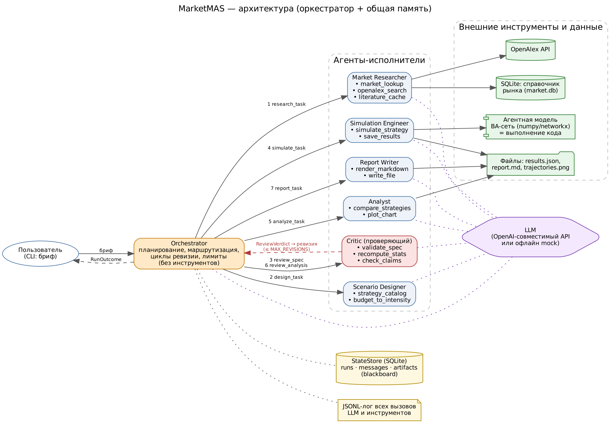

# MarketMAS — многоагентная ИИ-система моделирования маркетинговых ситуаций

Маркетолог задаёт вопрос обычным текстом («Что эффективнее для оператора связи с бюджетом 30 млн ₸ —
инфлюенсеры, случайный посев или массовая реклама?»). Команда из 7 агентов превращает вопрос в
вычислительный эксперимент на агентной модели рынка (сеть Barabási–Albert, конкуренция трёх брендов),
прогоняет парные симуляции, проверяет статистику и выводы и выдаёт отчёт с рекомендацией.

Проект выполнен по ТЗ «Многоагентная ИИ-система» (Ассайнмент 2, Ассайнмент 4, экзамен) в рамках магистерского
направления «Многоагентное моделирование маркетинговых ситуаций».



## Быстрый старт

```bash
git clone <repo> && cd market-mas
python -m venv .venv && source .venv/bin/activate      # Windows: .venv\Scripts\activate
pip install -r requirements.txt
cp .env.example .env                                     # по умолчанию LLM_PROVIDER=mock — работает без ключа

python -m marketmas run "Мы мобильный оператор. Бюджет 30 млн тенге. Что лучше: инфлюенсеры-хабы, случайный сэмплинг или массовая реклама?"
```

Результат: `outputs/<run_id>/report.md` (отчёт), `trajectories.png` (график), `simulation_results.json`
(сырые данные), `logs/run_<run_id>.jsonl` (лог всех вызовов), таблица нагрузки по агентам — в консоли.

### Режим с настоящей LLM

В `.env` (ключи **не хранятся в коде**, только в окружении; `.env` в `.gitignore`):

```ini
LLM_PROVIDER=openai
LLM_BASE_URL=https://api.openai.com/v1      # или https://api.groq.com/openai/v1, https://openrouter.ai/api/v1
LLM_API_KEY=...
LLM_MODEL=gpt-4o-mini
```

Локальная модель через Ollama: `LLM_BASE_URL=http://localhost:11434/v1`, `LLM_MODEL=qwen2.5:7b`, ключ не нужен.

Режим `mock` — детерминированный офлайн-режим: вместо модели вызывается эвристика агента, возвращающая JSON той же
схемы. Он нужен для воспроизводимых тестов и демонстрации без интернета; та же эвристика служит фолбэком, если реальная
LLM трижды вернула невалидный ответ.

## Команды

| Команда | Что делает |
|---|---|
| `python -m marketmas run "<бриф>"` | Полный прогон; флаги `--provider`, `--faults`, `--timeout`, `--max-steps`, `--quiet` |
| `python -m marketmas eval [S01 S05 …]` | Прогон тестовых сценариев → `outputs/eval_results.md` |
| `python -m marketmas load logs/run_<id>.jsonl --png load.png` | Распределение нагрузки по агентам (порог 40%) |
| `python -m marketmas show <run_id>` | Состояние прогона и трасса сообщений из SQLite |
| `python -m marketmas agents` | Таблица агентов (роль, входы/выходы, инструменты) |
| `pytest -q` | 9 модульных тестов + 16 сценариев (~70 с) |

## Агенты

| Агент | Роль | Инструменты |
|---|---|---|
| **Orchestrator** | Только планирует и распределяет задачи, ведёт циклы ревизии и лимиты | — |
| **Market Researcher** | Отрасль, параметры рынка, научные источники | `market_lookup` (SQLite), `openalex_search` (API), `literature_cache` |
| **Scenario Designer** | Бриф → формальная спецификация эксперимента | `strategy_catalog`, `budget_to_intensity` |
| **Critic** | Проверяет спецификацию до запуска и выводы после анализа | `validate_spec`, `recompute_stats`, `check_claims` |
| **Simulation Engineer** | План эксперимента и прогон агентной модели | `simulate_strategy` (выполнение кода), `save_results` |
| **Analyst** | Парные t-тесты, поправка Холма, график, рекомендация | `compare_strategies`, `plot_chart` |
| **Report Writer** | Итоговый отчёт | `render_markdown`, `write_file` |

Подробно: [docs/assignment2.md](docs/assignment2.md) (тема, архитектура, спецификация, форматы сообщений) и
[docs/assignment4.md](docs/assignment4.md) (реализация, нагрузка, надёжность, тесты).

## Структура

```
marketmas/
  agents/            orchestrator, market_researcher, scenario_designer, critic, simulation_engineer, analyst, report_writer
  tools/             simulator (ABM), market_db, literature (OpenAlex), stats_tools, validation, design_tools
  messages.py        типизированные сообщения (pydantic)
  state.py           SQLite-хранилище состояния (runs / messages / artifacts)
  logging_utils.py   JSONL-логирование вызовов
  limits.py          лимиты шагов и времени, детектор зацикливания
  llm.py             OpenAI-совместимый клиент + mock
  evaluate.py        прогон тестовых сценариев
prompts/             системные промпты агентов
scenarios/           16 тестовых сценариев с ожидаемым результатом (JSON)
data/                справочник рынка (CSV → SQLite), офлайн-кэш литературы
docs/                документация, схема, логи эталонного прогона, результаты тестов
tests/               pytest
```

## Ограничения

Параметры рынка в `data/market_benchmarks.csv` иллюстративные и требуют калибровки по реальным данным.
Модель упрощает поведение потребителей (логит-выбор, статичная сеть). p-значения отражают вариативность модели,
а не рынка. Подробнее — в разделе «Ограничения» [docs/assignment4.md](docs/assignment4.md).
