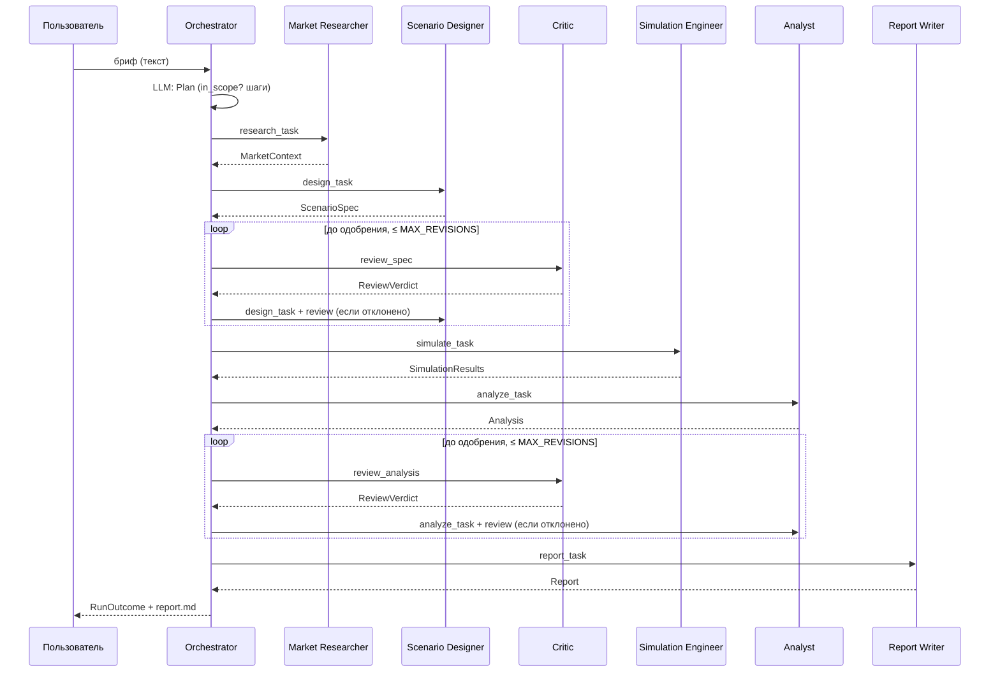

# Ассайнмент 2 — проектирование и прототип

**Проект:** MarketMAS — многоагентная ИИ-система моделирования маркетинговых ситуаций
**Магистрант:** Куат Надир, 7M06105 Computer Science & Engineering, AITU
**Научный руководитель:** Ахметжанова Ш. Е.

---

## 1. Тема и обоснование многоагентного подхода

### Прикладная задача

Маркетолог должен выбрать стратегию продвижения при ограниченном бюджете: посев через лидеров мнений (хабов),
случайный посев (сэмплинг), массовую рекламу, ценовую акцию; отдельно — как реагировать на репутационный кризис.
Натурный эксперимент дорог и необратим, поэтому стратегии сравнивают на агентной модели рынка. Это направление
моей магистерской работы: агентная модель конкуренции трёх брендов на безмасштабной сети Barabási–Albert с
парными прогонами и t-тестами. В статье этот подход показал преимущество посева через хабов над случайным посевом
и массовым охватом.

Проблема в том, что путь от вопроса маркетолога к выводу длинный и требует разных компетенций.
Нужно понять вопрос и отрасль, подобрать параметры рынка и литературу, формализовать сценарий, корректно
спланировать вычислительный эксперимент, провести статистический анализ с поправкой на множественные сравнения,
проверить, что выводы соответствуют числам, и изложить результат языком бизнеса. MarketMAS автоматизирует весь
этот путь.

### Почему команда агентов, а не один агент

| Аргумент | Пояснение |
|---|---|
| **Разные компетенции и разные инструменты** | Поиск литературы и рыночных данных, формализация сценария, выполнение кода модели, статистика и текст отчёта требуют разных инструментов и промптов. У одного агента было бы 13 инструментов (ограничение ТЗ — 5) и перегруженный контекст. |
| **Независимая проверка** | Аналитик, проверяющий сам себя, склонен подтверждать собственные выводы. Отдельный Critic **пересчитывает статистику сам** и сверяет с утверждениями аналитика. В сценарии S11 он ловит внедрённую «галлюцинацию» (Δ завышена на 2.5 п.п.) и возвращает анализ на доработку. |
| **Контроль до дорогого шага** | Симуляция — самый дорогой шаг. Critic проверяет спецификацию *до* запуска: в S06 запрос на 10 млн агентов и 5000 прогонов исправлен на допустимые значения без траты вычислений. |
| **Изоляция сбоев** | Падение OpenAlex затрагивает только Market Researcher: он переключается на офлайн-кэш (S08), а остальной конвейер не меняется. |
| **Детерминированность критичных чисел** | Числа (Δ, p, ДИ) получают только инструменты; LLM отвечает за интерпретацию. Разделение ролей не даёт модели «придумать» результат: Analyst не может подменить числа, Critic не может одобрить спецификацию, которая не прошла валидатор (жёсткое правило в коде). |
| **Масштабирование** | Новую стратегию или источник данных добавляют одному агенту, не трогая остальных. |

---

## 2. Архитектура

**Схема взаимодействия:** оркестратор + общая память (blackboard). Оркестратор рассылает задачи в порядке плана и
обрабатывает вердикты критика (цикл ревизии ≤ `MAX_REVISIONS`). Все артефакты (план, контекст рынка,
спецификация, результаты, анализ, вердикты, отчёт) и все сообщения сохраняются в SQLite-хранилище состояния.


Исходник схемы: [`architecture.dot`](architecture.dot) (Graphviz), векторная версия: [`img/architecture.svg`](img/architecture.svg).

### Поток выполнения



---

## 3. Спецификация агентов

| Агент | Роль | Входы | Выходы | Инструменты | Критерий завершения |
|---|---|---|---|---|---|
| **Orchestrator** | Планирует конвейер, распределяет задачи, управляет циклами ревизии и лимитами. Предметной работы не выполняет | Бриф (текст) | `Plan`, итоговый `RunOutcome` | — (только LLM-планирование) | Отчёт готов **или** прогон остановлен с понятным статусом (`out_of_scope`, `revision_limit`, `timeout`, `step_limit`, `failed`) |
| **Market Researcher** | Определяет отрасль, собирает параметры рынка и научные источники для калибровки | `research_task {brief}` | `MarketContext` | `market_lookup` (SQLite), `openalex_search` (OpenAlex API), `literature_cache` (файл-фолбэк) | Параметры рынка получены из БД и найден ≥1 источник |
| **Scenario Designer** | Формализует бриф в спецификацию эксперимента; при ревизии применяет исправления критика | `design_task {brief, market_context, [review], [previous_spec]}` | `ScenarioSpec` | `strategy_catalog`, `budget_to_intensity` | Спецификация собрана, интенсивности посчитаны инструментом |
| **Critic** (проверяющий) | Валидирует спецификацию до симуляции; независимо пересчитывает статистику и сверяет выводы | `review_spec {spec}` / `review_analysis {analysis, simulation_results}` | `ReviewVerdict {approved, issues[]}` | `validate_spec`, `recompute_stats`, `check_claims` | Вынесен вердикт; у каждой ошибки указаны поле и предлагаемое исправление |
| **Simulation Engineer** | Планирует эксперимент (прогоны, сиды, CRN) с учётом лимита времени и выполняет агентную модель | `simulate_task {spec, market_context}` | `SimulationResults` | `simulate_strategy` (выполнение кода ABM), `save_results` (файл) | Все стратегии прогнаны на одинаковых сидах, результаты сохранены в JSON |
| **Analyst** | Парные t-тесты всех пар, поправка Холма, ДИ, размер эффекта, график, интерпретация и рекомендация | `analyze_task {spec, simulation_results, [review]}` | `Analysis` | `compare_strategies`, `plot_chart` | Все пары сравнены, построен график, сформулированы выводы и ограничения |
| **Report Writer** | Резюме для руководителя и итоговый отчёт | `report_task {spec, market_context, simulation_results, analysis, reviews}` | `Report {path, headline}` | `render_markdown`, `write_file` | `report.md` записан в `outputs/<run_id>/` |

Роли не пересекаются: каждый инструмент принадлежит ровно одному агенту (это проверяет тест
`test_agents_have_at_most_5_tools_and_orchestrator_has_none`). Critic пересчитывает статистику своим инструментом
`recompute_stats`, а не берёт числа у Analyst: это осознанное дублирование ради независимой проверки.

### Внешние инструменты и источники данных (требование ≥ 2)

| Источник | Тип | Агент |
|---|---|---|
| OpenAlex API | внешний REST API (научные публикации) | Market Researcher |
| `market.db` (SQLite, строится из `data/market_benchmarks.csv`) | БД | Market Researcher |
| Агентная модель (numpy / networkx / scipy) | выполнение кода | Simulation Engineer |
| `simulation_results.json`, `report.md`, `trajectories.png`, `openalex_cache.json` | файлы | Simulation Engineer, Report Writer, Analyst, Market Researcher |

### Форматы сообщений

Все сообщения — pydantic-модели (`marketmas/messages.py`), сериализуются в JSON и сохраняются в таблицу `messages`.
Конверт:

```json
{
  "msg_id": "844f2b5a27c3",
  "run_id": "S01-10557101",
  "step": 10,
  "sender": "orchestrator",
  "recipient": "critic",
  "type": "task",
  "payload_type": "review_spec",
  "payload": { "spec": "<ScenarioSpec>" },
  "ts": "2026-10-05T14:29:18.631+00:00"
}
```

`type ∈ {task, result, review, error}`; `payload_type` задаёт схему полезной нагрузки. Пример ответа дизайнера
(реальный прогон S01):

```json
{
  "sender": "scenario_designer", "recipient": "orchestrator", "type": "result", "payload_type": "ScenarioSpec",
  "payload": {
    "title": "hub_seeding vs random_seeding vs mass_media (telecom)",
    "strategies": ["baseline", "hub_seeding", "random_seeding", "mass_media"],
    "budget_kzt": 30000000.0, "n_agents": 1000, "ba_m": 3, "n_steps": 60, "n_runs": 30,
    "intervention_step": 5, "shock": null,
    "intensities": {"random_seeds": 20, "hub_seeds": 7, "ad_boost": 0.5057, "price_cut": 0.075},
    "assumptions": ["Отрасль: telecom; фокальный бренд — Brand A", "n_agents не указан в брифе — принято 1 000"]
  }
}
```

Вердикт критика с замечаниями (сценарий S06, недопустимые параметры; фрагмент):

```json
{
  "target": "scenario_spec", "approved": false,
  "issues": [
    {"severity": "error", "field": "n_agents", "message": "n_agents=10000000 вне допустимого диапазона [100, 5000]", "suggested": 5000},
    {"severity": "error", "field": "n_runs",   "message": "n_runs=5000 вне допустимого диапазона [10, 100]", "suggested": 100}
  ]
}
```

| Полезная нагрузка | Основные поля |
|---|---|
| `Plan` | `in_scope`, `reason`, `steps[{agent, task}]` |
| `MarketContext` | `industry, brands, base_shares, quality, price, social_weight, price_sensitivity, churn_rate, cpm_kzt, seed_cost_kzt, references[], data_notes[]` |
| `ScenarioSpec` | `title, research_question, strategies[], budget_kzt, n_agents, ba_m, n_steps, n_runs, intervention_step, shock?, intensities, assumptions[]` |
| `ReviewVerdict` | `target, approved, issues[{severity, field, message, suggested}], comment` |
| `ExperimentPlan` | `n_runs, base_seed, common_random_numbers, rationale` |
| `SimulationResults` | `n_runs, n_agents, results[{strategy, final_shares[], mean_trajectory[], seeds_used}], results_file` |
| `Analysis` | `best_strategy, comparisons[{a, b, delta_pp, t_stat, p_value, p_holm, ci95_pp, cohen_dz}], claims[], interpretation, recommendation, caveats[]` |
| `Report` / `RunOutcome` | `path, headline` / `status, message, report_path, revisions, log_file` |

Ответ LLM валидируется по JSON-схеме модели. При ошибке агент делает повтор и передаёт текст ошибки модели;
после `LLM_RETRIES` неудач включается детерминированная эвристика, а в лог пишется `status=fallback`.

### Агентная модель (инструмент `simulate_strategy`)

* N потребителей — узлы графа Barabási–Albert (m = 3); K = 3 бренда, фокальный — индекс 0.
* На шаге потребитель с вероятностью `churn` пересматривает выбор:
  `U_ik = 2.0·q_k − 1.5·ps·p_k/p̄ + 1.2·sw·s_ik + 1.5·[k = текущий] + ad_k + Gumbel`,
  где `s_ik` — взвешенная доля соседей с брендом k; выбор — argmax (эквивалент логит-модели).
* Вмешательства при равном бюджете: **hub_seeding** — топ-k узлов по степени становятся адвокатами (вес 2,
  отток ×0.3; контакт с хабом в 3 раза дороже); **random_seeding** — k случайных узлов; **mass_media** — бонус
  полезности на 15 шагов; **price_cut** — скидка на 20 шагов. **Shock** — падение качества бренда (кризис).
* Common random numbers: одинаковый seed даёт одинаковую сеть и шум для всех стратегий, поэтому сравнения парные.

---

## 4. Сбалансированность ролей

Типовой сценарий (S01, лог [`sample_run/typical_run.jsonl`](sample_run/typical_run.jsonl)):

| Агент | LLM | Инструменты | Всего | Доля |
|---|---|---|---|---|
| market_researcher | 1 | 5 | 6 | 22.2% |
| simulation_engineer | 1 | 5 | 6 | 22.2% |
| critic | 2 | 3 | 5 | 18.5% |
| scenario_designer | 1 | 2 | 3 | 11.1% |
| analyst | 1 | 2 | 3 | 11.1% |
| report_writer | 1 | 2 | 3 | 11.1% |
| orchestrator | 1 | 0 | 1 | 3.7% |
| **Итого** | | | **27** | **max 22.2% ≤ 40%** |


У Market Researcher 3 из 6 вызовов — повторы `openalex_search`: OpenAlex был недоступен из среды разработки,
сработал фолбэк на кэш. При доступном API у агента 3 вызова. Число вызовов Simulation Engineer растёт с числом
стратегий (по одному вызову на стратегию), но даже при максимуме в 5 стратегий его доля ≈ 25%.

---

## 5. Прототип

Прототип реализует все 7 агентов (больше требуемого минимума в 2 взаимодействующих агента). Трасса сообщений
типового прогона (`python -m marketmas show <run_id>`, файл [`sample_run/message_trace.txt`](sample_run/message_trace.txt)):

```
[01]        orchestrator → market_researcher   task    research_task
[07]   market_researcher → orchestrator        result  MarketContext
[07]        orchestrator → scenario_designer   task    design_task
[10]   scenario_designer → orchestrator        result  ScenarioSpec
[10]        orchestrator → critic              task    review_spec
[12]              critic → orchestrator        review  ReviewVerdict
[12]        orchestrator → simulation_engineer task    simulate_task
[18] simulation_engineer → orchestrator        result  SimulationResults
[18]        orchestrator → analyst             task    analyze_task
[21]             analyst → orchestrator        result  Analysis
[21]        orchestrator → critic              task    review_analysis
[24]              critic → orchestrator        review  ReviewVerdict
[24]        orchestrator → report_writer       task    report_task
[27]       report_writer → orchestrator        result  Report
```

Итоговый отчёт этого прогона: [`sample_run/report.md`](sample_run/report.md).
