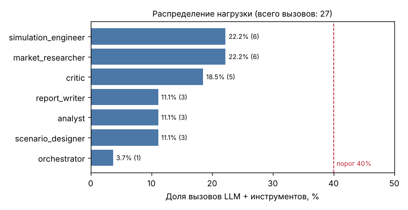

# Ассайнмент 4 — работающая система

Все 7 агентов реализованы и работают в одном конвейере (архитектура и спецификация — в [assignment2.md](assignment2.md)).
Проверка одной командой:

```bash
pytest -q                       # 25 тестов: 9 модульных + 16 сценариев
python -m marketmas eval        # те же 16 сценариев с таблицей результатов
```

## 1. Все агенты работают вместе

Типовой прогон (S01): 7 агентов, 14 сообщений, 27 вызовов LLM и инструментов, ~5 с в офлайн-режиме.
Артефакты в [`sample_run/`](sample_run/): `report.md`, `trajectories.png`, `simulation_results.json`,
`typical_run.jsonl` (полный лог), `message_trace.txt`, `load_table.md`.


## 2. Распределение нагрузки (≤ 40% на агента)

Нагрузка — это вызовы LLM плюс вызовы инструментов, включая повторные попытки (`python -m marketmas load <лог>`).

| Агент | LLM | Инструменты | Всего | Доля |
|---|---|---|---|---|
| market_researcher | 1 | 5 | 6 | 22.2% |
| simulation_engineer | 1 | 5 | 6 | 22.2% |
| critic | 2 | 3 | 5 | 18.5% |
| scenario_designer | 1 | 2 | 3 | 11.1% |
| analyst | 1 | 2 | 3 | 11.1% |
| report_writer | 1 | 2 | 3 | 11.1% |
| orchestrator | 1 | 0 | 1 | 3.7% |
| **Итого** | | | **27** | **max 22.2%** |



Во всех 12 сценариях, дошедших до отчёта (S01–S06, S08–S11, S15, S16), максимальная доля одного агента —
от 20.6% до 26.7% ([test_results.md](test_results.md), логи в [`sample_run/scenario_logs/`](sample_run/scenario_logs/)).
В прерванных прогонах доля выше по построению: в S07 был единственный вызов, в S13/S14 прогон остановлен лимитом.
Это не типовые сценарии, и требование ТЗ к ним не относится.

## 3. Интеграция инструментов и данных

| Инструмент | Тип | Что делает |
|---|---|---|
| `openalex_search` | внешний API | Запрос `api.openalex.org/works`, сортировка по цитированиям |
| `literature_cache` | файл | Офлайн-кэш 8 ключевых работ, ранжирование по запросу |
| `market_lookup` | SQLite | Параметры рынка по 7 отраслям + `default`; БД строится из CSV и пересобирается при его изменении |
| `simulate_strategy` | выполнение кода | Агентная модель (networkx + numpy), парные прогоны с общими сидами |
| `save_results`, `write_file`, `plot_chart` | файлы | JSON-результаты, Markdown-отчёт, PNG-график |
| `compare_strategies`, `recompute_stats` | вычисления | Парный t-тест, 95% ДИ, Cohen's d_z, поправка Холма (scipy) |

## 4. Обработка ошибок, лимиты, защита от зацикливания

| Механизм | Реализация | Сценарий |
|---|---|---|
| Повтор вызова инструмента | `TOOL_RETRIES=2`, экспоненциальная задержка; неповторяемые ошибки (`retryable=False`) сразу пробрасываются | S09 |
| Фолбэк источника | OpenAlex недоступен → `literature_cache`, причина записывается в отчёт | S08 |
| Невалидный ответ LLM | pydantic-валидация → повтор с текстом ошибки → детерминированная эвристика (`status=fallback`) | S10 |
| Контроль качества | Critic до симуляции (границы, вычислительный объём, логика) и после анализа (независимый пересчёт) | S06, S11 |
| Лимит ревизий | `MAX_REVISIONS=2` на спецификацию и на анализ → статус `revision_limit` | S12 |
| Лимит шагов | `MAX_STEPS=60`: каждый вызов LLM/инструмента тратит шаг → `step_limit` | S14 |
| Лимит времени | `RUN_TIMEOUT_S=300`: проверка на каждом шаге + дедлайн, передаваемый в симулятор → `timeout` | S13 |
| Детектор зацикливания | одинаковая задача одному агенту > `LOOP_REPEAT_LIMIT=3` раз → остановка | `limits.LoopDetected` |
| Адаптация к времени | Simulation Engineer сокращает число прогонов, если они не успевают в оставшееся время (но не меньше 10) | `plan_experiment` |
| Понятное сообщение | Любой исход — `RunOutcome{status, message}` без трейсбэка; статус и сообщение сохраняются в `runs` | все |
| Нет ключа API | Ошибка конфигурации с подсказкой (`LLM_API_KEY не задан…`) | `test_missing_api_key_gives_clear_error` |
| Внедрение отказов | `FAULTS=openalex_down,sim_flaky,llm_garbage,critic_reject,analyst_hallucinate,slow_sim` | S08–S13 |

## 5. Логирование вызовов

Каждый вызов LLM и инструмента, каждое сообщение и событие пишется в `logs/run_<run_id>.jsonl`:

```json
{"ts": "2026-10-05T14:29:00.468+00:00", "run_id": "20261005-192857-e007", "step": 14, "agent": "simulation_engineer", "kind": "tool", "name": "simulate_strategy", "status": "ok", "duration_ms": 1334.2, "attempt": 1, "input": "{\"spec\": {\"title\": \"hub_seeding vs random_seeding vs mass_media (telecom)\", \"research_question\": \"Мы мобильный оператор в Казахстане. Бюджет 30 млн тенге. Что эффективнее для роста доли: посев через инфлюенсеров-хабов, случайный сэмплинг или массовая реклама?\", \"strategies\": [\"baseline\", \"hub_see...", "output": "{\"strategy\": \"baseline\", \"final_shares\": \"<30 чисел, mean=0.3091>\", \"mean_trajectory\": \"<60 чисел, mean=0.3057>\", \"seeds_used\": 0}"}
```

Поля: `kind ∈ {llm, tool, message, event}`, `status ∈ {ok, error, retry, fallback, warning, <итоговый статус>}`,
`attempt`, `duration_ms`, сокращённые вход и выход, `error`, для LLM — `provider` и `usage` (токены).
Сообщения между агентами дополнительно хранятся в SQLite (`messages`), артефакты — в `artifacts`.

## 6. Тестовые сценарии

16 сценариев (`scenarios/S01–S16.json`) с формализованными ожидаемыми результатами. Проверяются статус, лучшая
стратегия, знак и значимость эффектов, параметры спецификации, наличие или отсутствие записей в логе,
содержимое отчёта и баланс нагрузки. **Пройдено 16/16 (100%).**

| ID | Сценарий | Ожидаемый результат | Факт |
|---|---|---|---|
| S01 | Типовой: хабы vs случайный посев vs реклама (телеком) | completed; лучшая — hub_seeding; хабы > случайного посева (значимо); нагрузка ≤ 40% | ✅ |
| S02 | Англоязычный бриф: FMCG, хабы vs случайный посев | completed; бюджет 20 млн распознан; hub > random | ✅ |
| S03 | Ценовая война vs массовая реклама (финтех) | completed; скидка даёт Δ > 0 к baseline; лучшая — mass_media или price_cut | ✅ |
| S04 | Репутационный кризис (доставка еды) | completed; в спецификации есть shock; в отчёте раздел о кризисе | ✅ |
| S05 | Явные параметры из брифа | N = 2000, 40 прогонов, 80 шагов, baseline + hub_seeding | ✅ |
| S06 | Недопустимые параметры (10 млн агентов, 5000 прогонов) | completed после ≥ 1 ревизии; N ≤ 5000, прогонов ≤ 100 | ✅ |
| S07 | Запрос вне предметной области | out_of_scope; симуляция не запускалась | ✅ |
| S08 | Отказ OpenAlex | completed; источники из кэша, отметка `[cache]` в отчёте | ✅ |
| S09 | Временный сбой симулятора | попытка 1 — error, попытка 2 — ok; completed | ✅ |
| S10 | Невалидный JSON от LLM | llm-вызовы со status=retry; completed; нагрузка ≤ 40% | ✅ |
| S11 | «Галлюцинация» аналитика | Critic отклонил неверную Δ; ревизия анализа; completed | ✅ |
| S12 | Critic всегда отклоняет | revision_limit после 2 ревизий; симуляция не запускалась | ✅ |
| S13 | Лимит времени (3 с, медленный симулятор) | timeout с понятным сообщением | ✅ |
| S14 | Лимит шагов (10) | step_limit с понятным сообщением | ✅ |
| S15 | Отрасль не распознана | параметры default, отмечено в отчёте | ✅ |
| S16 | Минимальный бриф без чисел | допущения по умолчанию перечислены в отчёте | ✅ |

Полная таблица с числом вызовов, долей нагрузки и временем: [test_results.md](test_results.md).

## 7. Ограничения (к защите)

* **Офлайн-режим.** Результаты тестов получены с `LLM_PROVIDER=mock`, где роль модели играет эвристика. Это
  проверяет архитектуру, протокол сообщений, надёжность и баланс, но не качество рассуждений LLM. Для демонстрации
  с реальной моделью достаточно задать ключ в `.env`: сценарии и проверки те же.
* **Параметры рынка иллюстративные.** Справочник `data/market_benchmarks.csv` нужно калибровать по реальным данным
  (доли, отток, CPM, стоимость контакта).
* **Модель упрощена:** статичная сеть, логит-выбор, три бренда, один фокальный.
* **Малые p-значения.** Из-за общих сидов (CRN) парная дисперсия мала, поэтому p-значения очень маленькие. Они
  говорят о различии стратегий *в модели*, а не о достоверности на рынке.
* **Разбор брифа в mock-режиме** основан на ключевых словах (RU/EN). Нестандартные формулировки распознаёт
  реальная LLM.
