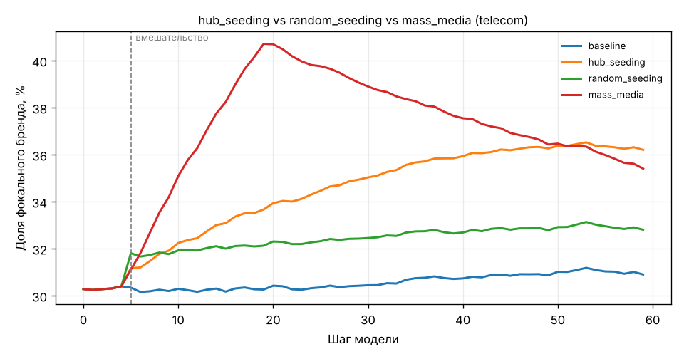

# Посев через хабов — лучшая стратегия в сценарии «hub_seeding vs random_seeding vs mass_media (telecom)»

Агентная модель (30 парных прогонов) показывает, что «посев через хабов» даёт наибольшую итоговую долю фокального бренда (+5.30 п.п. к варианту без вмешательства). Рекомендуется «посев через хабов».

## Вопрос и постановка эксперимента

**Вопрос:** Мы мобильный оператор в Казахстане. Бюджет 30 млн тенге. Что эффективнее для роста доли: посев через инфлюенсеров-хабов, случайный сэмплинг или массовая реклама?

| Параметр | Значение |
|---|---|
| Отрасль / фокальный бренд | telecom / Brand A |
| Стратегии | без вмешательства, посев через хабов, случайный посев, массовая реклама |
| Бюджет | 30 000 000 ₸ |
| Сеть | Barabási–Albert, N = 1000, m = 3 |
| Горизонт / шаг вмешательства | 60 / 5 |
| Прогонов (парные, общие сиды) | 30 |
| Интенсивности | хабов 7, случайных 20, реклама +0.5057, скидка 7.5% |

## Результаты

| Стратегия | Средняя итоговая доля, % |
|---|---|
| без вмешательства | 30.91 |
| посев через хабов **(лучшая)** | 36.21 |
| случайный посев | 32.81 |
| массовая реклама | 35.41 |

| Сравнение | Δ, п.п. | 95% ДИ | t | p (Холм) | d_z |
|---|---|---|---|---|---|
| посев через хабов vs без вмешательства | +5.30 | [+4.49; +6.12] | 13.36 | 2.56e-13 | 2.44 |
| случайный посев vs без вмешательства | +1.90 | [+1.63; +2.18] | 14.05 | 8.99e-14 | 2.56 |
| массовая реклама vs без вмешательства | +4.50 | [+4.18; +4.83] | 28.61 | 4.98e-22 | 5.22 |
| посев через хабов vs случайный посев | +3.40 | [+2.58; +4.22] | 8.52 | 4.37e-09 | 1.56 |
| посев через хабов vs массовая реклама | +0.80 | [+0.03; +1.57] | 2.11 | 0.0436 | 0.39 |
| случайный посев vs массовая реклама | -2.60 | [-3.00; -2.20] | -13.30 | 2.56e-13 | -2.43 |

## Интерпретация

Лучшая стратегия по итоговой доле фокального бренда — «посев через хабов» (36.21%). Парные сравнения: «посев через хабов» vs «без вмешательства»: Δ = +5.30 п.п. (95% ДИ +4.49…+6.12; p_Holm = 2.56e-13; d_z = 2.44); «случайный посев» vs «без вмешательства»: Δ = +1.90 п.п. (95% ДИ +1.63…+2.18; p_Holm = 8.99e-14; d_z = 2.56); «массовая реклама» vs «без вмешательства»: Δ = +4.50 п.п. (95% ДИ +4.18…+4.83; p_Holm = 4.98e-22; d_z = 5.22); «посев через хабов» vs «случайный посев»: Δ = +3.40 п.п. (95% ДИ +2.58…+4.22; p_Holm = 4.37e-09; d_z = 1.56); «посев через хабов» vs «массовая реклама»: Δ = +0.80 п.п. (95% ДИ +0.03…+1.57; p_Holm = 0.0436; d_z = 0.39); «случайный посев» vs «массовая реклама»: Δ = -2.60 п.п. (95% ДИ -3.00…-2.20; p_Holm = 2.56e-13; d_z = -2.43).

## Рекомендация

Рекомендуется «посев через хабов».

## Следующие шаги

- Откалибровать параметры рынка по реальным данным (доли, отток, CPM)
- Проверить устойчивость вывода при другой топологии сети и бюджете ±50%
- Спланировать пилот с контрольной группой для эмпирической проверки

## Ограничения

- Параметры рынка иллюстративные и требуют калибровки по реальным данным
- Модель упрощает поведение: логит-выбор, статичная сеть Barabási–Albert
- Число прогонов 30; p-значения отражают вариативность модели, а не рынка
- Иллюстративные параметры мобильной связи (3 оператора); требуют калибровки по данным рынка
- OpenAlex недоступен (market_researcher.openalex_search: не удалось после 3 попыток: OpenAlex: URLErro…) — источники взяты из офлайн-кэша
- Допущение: Отрасль: telecom; фокальный бренд — Brand A
- Допущение: Все активные стратегии сравниваются при одинаковом бюджете
- Допущение: n_agents не указан в брифе — принято 1 000
- Допущение: n_runs не указан в брифе — принято 30
- Допущение: n_steps не указан в брифе — принято 60

## Проверка критиком

- Спецификация: одобрено (ревизий: 0). Замечаний, блокирующих продолжение, нет.
- Анализ: одобрено (ревизий: 0). Замечаний, блокирующих продолжение, нет.

## Источники

- Maximizing the Spread of Influence through a Social Network (2003). *KDD 2003*. https://doi.org/10.1145/956750.956769 [cache]
- Seeding Strategies for Viral Marketing: An Empirical Comparison (2011). *Journal of Marketing*. https://doi.org/10.1509/jmkg.75.6.55 [cache]
- The Role of Hubs in the Adoption Process (2009). *Journal of Marketing*. https://doi.org/10.1509/jmkg.73.2.1 [cache]
- Influentials, Networks, and Public Opinion Formation (2007). *Journal of Consumer Research*. https://doi.org/10.1086/518527 [cache]
- Emergence of Scaling in Random Networks (1999). *Science*. https://doi.org/10.1126/science.286.5439.509 [cache]
